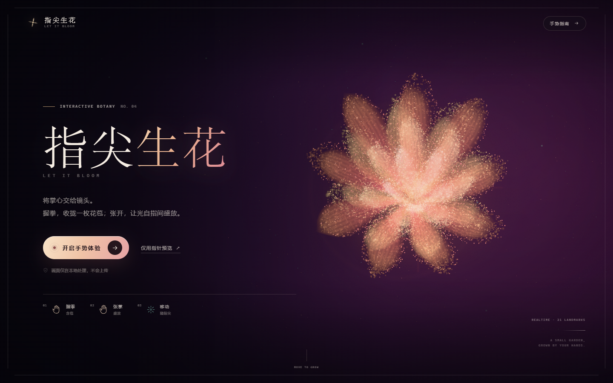
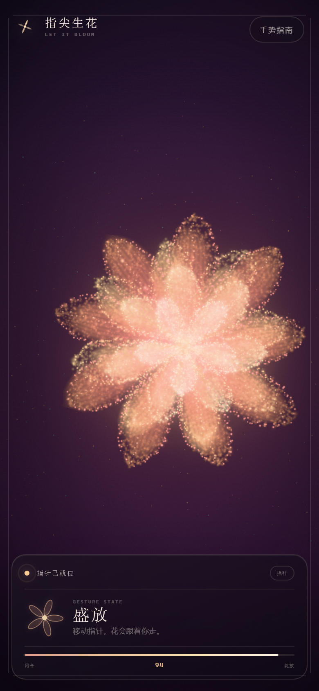

# 指尖生花 · Let It Bloom

> 握拳，收拢一枚花苞；张开，让光自指间盛放。

一场由 **Three.js 粒子系统** 与 **MediaPipe Hands** 驱动的实时手势花园。手掌被摄像头捕捉后，21 个手部关键点会转化为一朵会呼吸的光粒子花：握拳时花瓣收拢成发光的苞，张掌时粒子向外绽放，花朵随掌心移动，并在指尖留下一枚微光。

**在线体验：https://ltzhouuu.github.io/bloom/**  
**源码仓库：https://github.com/ltzhouuu/bloom**



<p align="center">
  
</p>

## 在线访问

- GitHub Pages：**https://ltzhouuu.github.io/bloom/**
- 直接演示（免摄像头）：**https://ltzhouuu.github.io/bloom/?demo=1**
- GitHub Pages 已启用 HTTPS，摄像头权限可直接在浏览器中请求；访问者的视频流仍然只在本地处理。
- 首次点击「开启手势体验」时，浏览器需要下载约 8 MB 的手部模型；GitHub Pages 在部分网络下约需 20–30 秒。页面会显示加载说明，超过 12 秒会提供「先使用指针预览」按钮，不会无限卡住。


## 快速开始

只需要 Node.js 18+。所有前端依赖（Three.js、MediaPipe Hands、WASM 与模型文件）都已经放在 `vendor/` 内，无需安装、无需构建、可以离线运行。

```bash
cd finger-bloom
node server.mjs
```

打开 **http://127.0.0.1:4173**，点击「开启手势体验」并允许摄像头即可。

也可以使用 npm script：

```bash
npm start
```

> 摄像头需要**安全上下文**：本机的 `http://127.0.0.1` / `http://localhost` 可以正常使用。如果从其他设备通过局域网 IP 访问，请改用 HTTPS。直接双击 `index.html` 以 `file://` 打开无法使用摄像头，也无法加载 ES Module。

需要改端口时：

```bash
# macOS / Linux
PORT=8080 node server.mjs

# Windows PowerShell
$env:PORT=8080; node server.mjs
```

## 手势与操作

| 操作 | 结果 |
| --- | --- |
| 握拳 | 花瓣与粒子收拢，变为发光花苞 |
| 张开手掌 | 花朵逐层绽放，并触发一次向外扩散的粒子脉冲 |
| 移动手掌 | 花朵跟随掌心，指尖微光跟随食指 |
| 无摄像头 / 指针预览 | 按住画面合拢花苞，松开让花盛放 |
| 方向键 | 指针模式下移动花朵 |
| 空格键 | 指针模式下按住合拢，松开绽放 |

- 如果拒绝摄像头权限，页面会给出提示；点击「仅用指针预览」仍可体验全部视觉与动效。
- 右上角「手势指南」随时可以重新查看操作说明。
- 摄像头预览右上角的小相机按钮可以隐藏 / 显示手部画面，识别仍在后台进行。
- 直接访问 `http://127.0.0.1:4173/?demo=1` 可跳过摄像头、以指针模式自动开始，适合演示与录屏。

## 视觉与技术

### 手势识别

- 使用 MediaPipe Hands 的原生 21 关键点结果（`multiHandLandmarks`）。
- 手部姿态由两部分共同判断：指尖关节的伸直程度，以及指尖相对掌心 / 手掌宽度的伸展距离；五指加权后得到连续的 `openness ∈ [0,1]`。
- 使用中值滤波和指数平滑吸收单帧抖动；视觉上再用弹簧阻尼把 openness 转换为花朵的开合，避免手势与画面生硬同步。
- 如果手短暂离开画面，花朵会保持一小段时间再缓缓回到安静的等待状态。
- 摄像头流仅在浏览器内处理，不会发送到任何服务器。

### 花朵渲染

- 手写 GLSL 顶点着色器：每颗粒子在「闭合花苞位置」与「绽放位置」之间带延迟地插值，延迟按花层和花瓣错开，形成逐层打开的效果。
- 约 21,000 个粒子构成花瓣、轮廓、花脉、金色花心与四周漂浮花粉；花瓣轮廓使用连续的发光粒子描边。
- 另有一层低透明度的「花瓣薄雾」曲面为粒子提供柔和体积感；所有花瓣都参与绽放动画，并使用加法混合。
- 独立的指尖光晕、花开 / 花合粒子爆发、空气尘埃、呼吸感背景与 UnrealBloom 后处理共同完成氛围。
- 自定义 GLSL 背景包含缓慢流动的云雾与星点；UI 使用原生 CSS，包含响应式布局、移动端布局和 `prefers-reduced-motion` 降级。

### 交互流程

- 未开始：自动演示模式，花朵缓慢呼吸式开合。
- 摄像头模式：手部结果驱动锚点、开合、倾斜与指尖光点；没有手时回到「静候」花苞。
- 指针模式：空白区域按下时为握拳，松开时为张掌；花朵跟随指针，并保留键盘替代操作。
- 支持 `?demo=1`（免摄像头演示）与 `?debug=1`（调试状态）两个 URL 参数。

## 项目结构

```text
finger-bloom/
├── index.html                 # 页面骨架与无障碍文案
├── .nojekyll                  # GitHub Pages 直接按静态文件发布
├── styles/main.css            # 视觉系统、响应式布局、动效
├── src/
│   ├── main.js                # 状态机、界面绑定、输入与动画循环
│   ├── flower.js              # Three.js 场景、粒子几何、GLSL、后处理
│   ├── handTracker.js         # 摄像头、MediaPipe 初始化与推理循环
│   ├── gesture.js             # 21 关键点 → 五指伸展度 → openness
│   └── utils.js               # 阻尼、钳制、随机数等小工具
├── server.mjs                 # 本地零依赖静态 HTTP 服务
├── vendor/
│   ├── three/                 # Three.js r169 与 bloom 后处理依赖
│   └── mediapipe/             # Hands 运行库、WASM、模型与资源
├── docs/                      # README 预览图
└── tools/
    ├── deploy-pages.mjs       # 通过 GitHub API 发布到 Pages（需要临时 token）
    ├── fetch-vendor.mjs       # 重新下载 vendor 依赖（需要网络）
    ├── test-gestures.mjs      # 用 MediaPipe 官方关键点样本验证手势分类
    └── fixtures/              # 官方手势样本（Apache 2.0，离线可用）
```

## 验证

- 使用 MediaPipe 官方手势关键点样本验证了分类器：

  | 样本 | openness | 识别结果 |
  | --- | --- | --- |
  | 张开右手（正立） | 0.980 | 五指全开 |
  | 张开右手（旋转） | 0.991 | 五指全开 |
  | 握拳 | 0.036 | 完全收拢 |
  | 竖大拇指 | 0.157 | 单指伸展 |
  | 比耶 | 0.498 | 部分展开 |
  | 单指向上 | 0.295 | 接近收拢 |

  运行 `node tools/test-gestures.mjs` 或 `npm test` 可复现，关键点样本已经包含在 `tools/fixtures/` 中，无需联网。

- 使用 Chrome 的假摄像头验证了本地 MediaPipe WASM / 模型加载、摄像头初始化、29 FPS 推理与 HUD 流转。
- 使用无头 Chrome 验证了桌面、移动端、横屏布局与指针开合、指南弹窗、权限拒绝兜底。

## 兼容性

- 推荐 Chrome / Edge 最新版本；Safari 16+、Firefox 较新版本也可运行。
- 需要 WebGL 2、ES Modules、`getUserMedia`。
- 摄像头识别质量依赖环境光线与手掌是否完整入镜。
- 低端设备上，粒子数量和 bloom 仍保持较克制的开销；如遇卡顿可等待加载完成后关闭其他占用摄像头 / GPU 的应用。

## 第三方依赖

- [Three.js](https://threejs.org/) r169 — MIT License
- [MediaPipe Hands](https://developers.google.com/mediapipe/solutions/vision/hand_landmarker) (legacy Hands Solution) — Apache License 2.0
- 两者的运行文件已包含在 `vendor/` 中；许可证说明见 [THIRD_PARTY_NOTICES.md](./THIRD_PARTY_NOTICES.md)。
